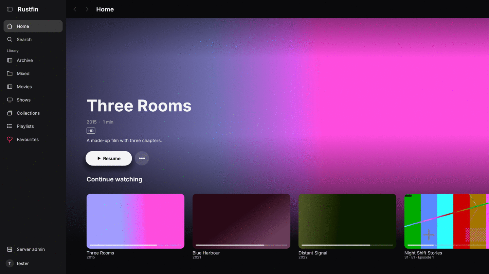
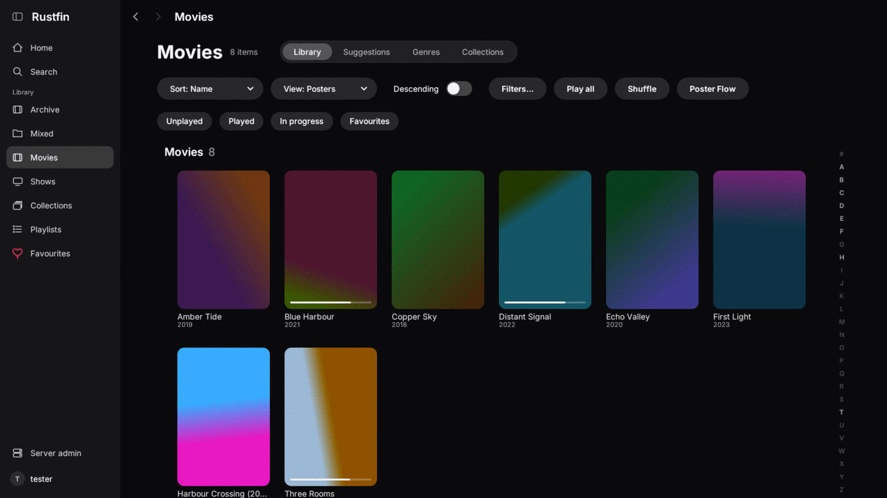
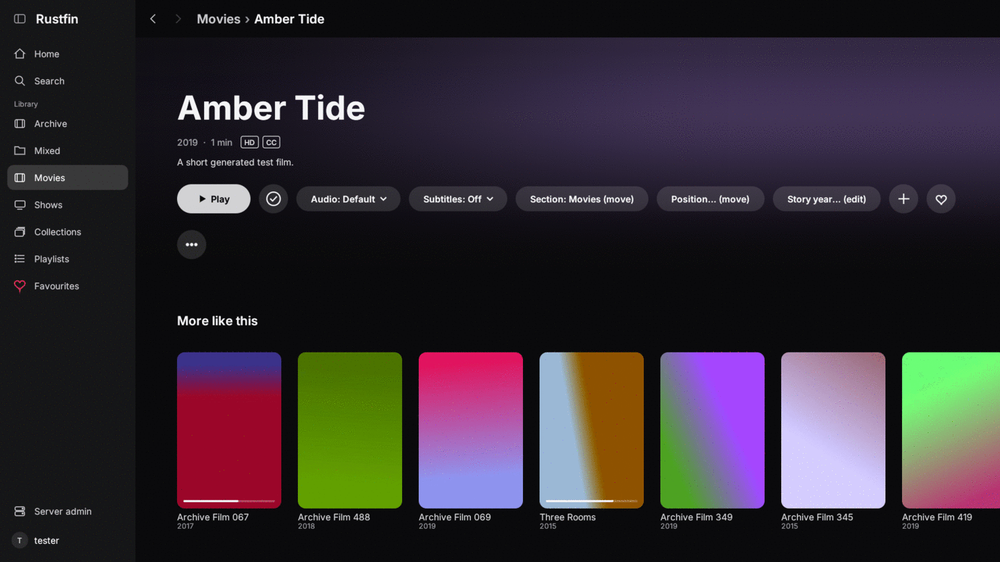
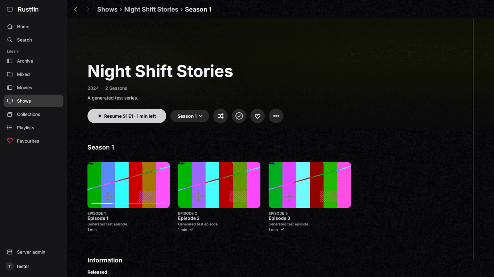
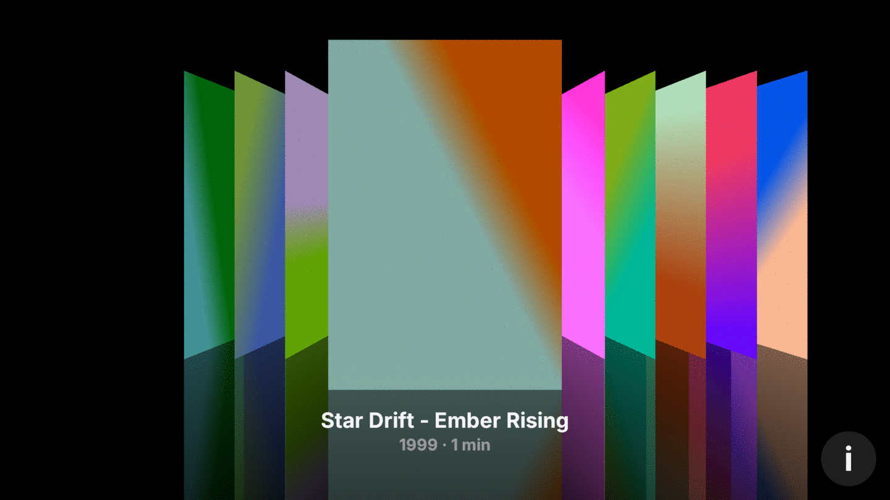
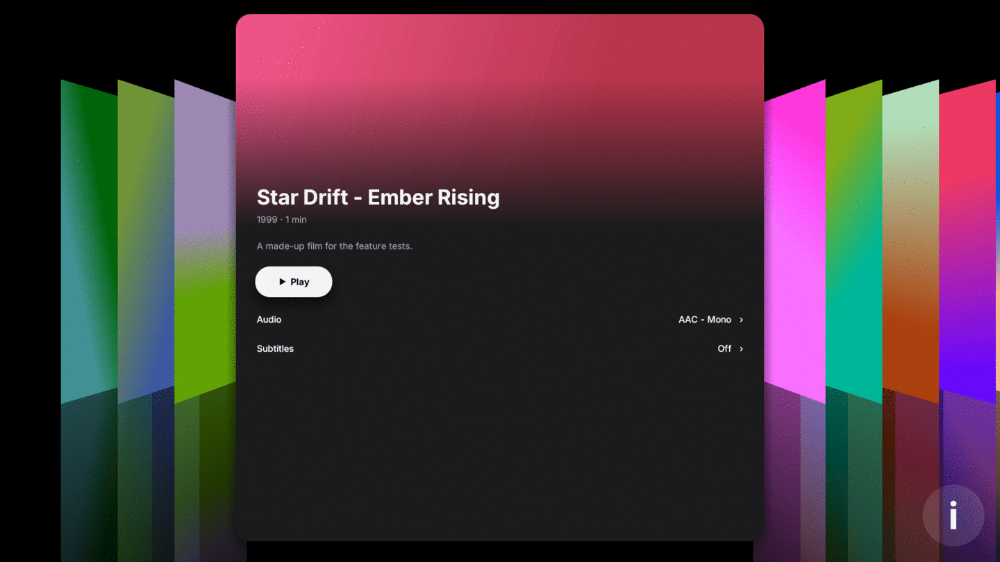
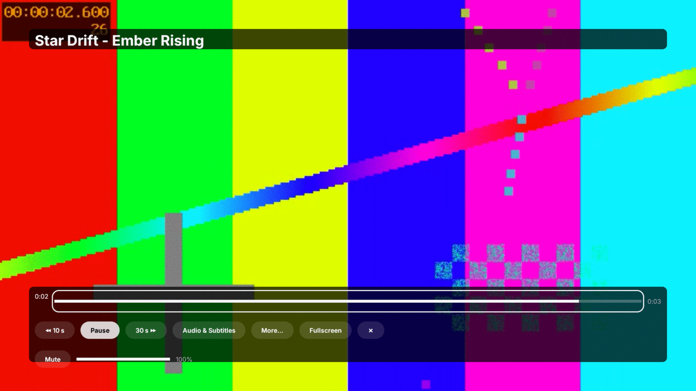
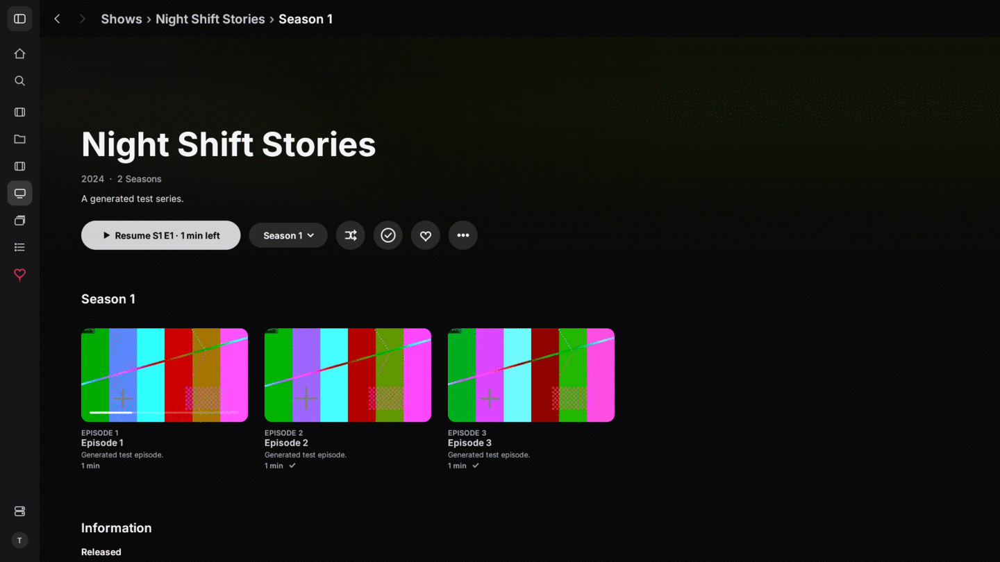

# Rustfin — a fast native Jellyfin client

Rustfin is a desktop client for [Jellyfin](https://jellyfin.org) media servers, written in Rust. It draws its own
interface with [egui](https://github.com/emilk/egui) on OpenGL and plays video with
[libmpv](https://mpv.io). No web view, no Electron: it starts in well under a second and scrolls a 500-film library
at hundreds of frames per second even on software rendering.

It works with any Jellyfin server 10.8 or newer (developed against 10.10).

| | |
|---|---|
|  |  |
|  |  |
|  |  |
|  |  |

*Screenshots from the throwaway test server (generated test videos, made-up titles). Poster Flow is Cover Flow–style
browsing: the front is the row of covers, the back is the flipped poster with details and Play.*

## Status

Early, but complete enough to use day to day.

- **Windows** (x86_64): zip with `Rustfin.exe` + `libmpv-2.dll`. Cross-built from Linux; tested under Wine.
- **macOS** (Apple Silicon): `Rustfin.app` with libmpv bundled; built and tested on a MacBook.
- **Linux**: builds and runs (it is the development platform), not packaged yet.
- **Samsung TV (Tizen)**: a **working trial**. The native app (a C# EFL shell around the same Rust core) installs
  next to the stock Jellyfin app and never replaces it. On the Samsung TV emulator, against the stock app: a faster
  cold start (Home with posters in about 1.9 s vs 2.4 s), about a third of the memory (roughly 83–100 MB vs
  270–310 MB) and faster seeks. Key response (scrolling) is still being worked on: about 20 ms for the stock app
  vs about 130 ms for ours. A web (`.wgt`) build is the fallback. See `tv/README.md`.
- **Parity:** 138 of the 142 jellyfin-web basics for films, TV and server admin are done. The setup wizard is not
  included; app language and colour themes come later.

What it does:

- Finds servers on your network (Jellyfin discovery) or takes a typed address.
- Signs in with a password, Quick Connect, or the switch-user picker, and remembers the server and sign-in.
- An Apple TV–style look: big hero on Home, rounded cards, one set of colours, sizes and timings in a single `Theme`
  struct (`core/src/theme.rs`).
- Home: Continue watching, Next up, Latest per library, Libraries.
- Library grids, film / series / season / episode pages, and search with a Top results list.
- **Poster Flow** (inspired by Cover Flow): flick through a library as a row of 3D covers with reflections, then
  flip a poster to see its details and Play.
- Desktop: a sidebar, a Back / Forward toolbar and breadcrumbs. Back works with Esc, Backspace, Alt+←/→,
  Cmd+[ / ], and mouse buttons 4 and 5.
- A remote-first player: Left/Right seek, an Audio & Subtitles panel with readable track names (including external
  subtitle files), trickplay thumbnails, a play queue, resume, progress reported to the server, mark watched, and
  an "Up next" countdown with auto-play of the next episode.
- On the TV: an on-screen keyboard, so no typing on a phone is needed.
- Remote-style keys first (arrows, Enter, Esc/Backspace = back, Space = pause); mouse works too.

## Building

See **[BUILDING.md](BUILDING.md)**, written so that a person or a coding agent can follow it step by step.

## Layout

```
core/      jf-core: Jellyfin API, settings, discovery, screens, drawing, theme (no window, no player)
desktop/   jf-desktop: window, keyboard, libmpv player → the `rustfin` binary
tools/     test server, render tests, benchmarks, packaging (Windows zip, macOS .app), leak gate
tv/        Samsung Tizen port: native (C# shell + Rust core) and web fallback
```

## Credits

Some trial and test screenshots may show Blender open movies; where one does, it is credited here:
*Sintel*, *Tears of Steel*, *Big Buck Bunny* and the other Blender Foundation films are © Blender Foundation |
www.blender.org, released under [CC BY 3.0](https://creativecommons.org/licenses/by/3.0/). The screenshots in
`docs-public/shots/` themselves use generated test titles only, so none of those films appear in them.

## Licence

Rustfin is MIT-licensed (see `LICENSE`). Its Rust dependencies are permissively licensed (MIT / Apache-2.0 / BSD /
ISC / Zlib and similar).

**libmpv is not part of this repository.** The Windows and macOS packages bundle a libmpv build, and those builds are
usually GPL-2.0-or-later (mpv with FFmpeg). If you pass such a package on, you take on the GPL's source-code duty for
libmpv: point to the exact upstream build and its sources (see `tools/package/LICENSES/mpv-and-ffmpeg.txt`), or
include them. Rustfin loads libmpv at run time and keeps its own code MIT.

Jellyfin is a trademark of its respective owners; Rustfin is an independent client and not affiliated with the
Jellyfin project.
