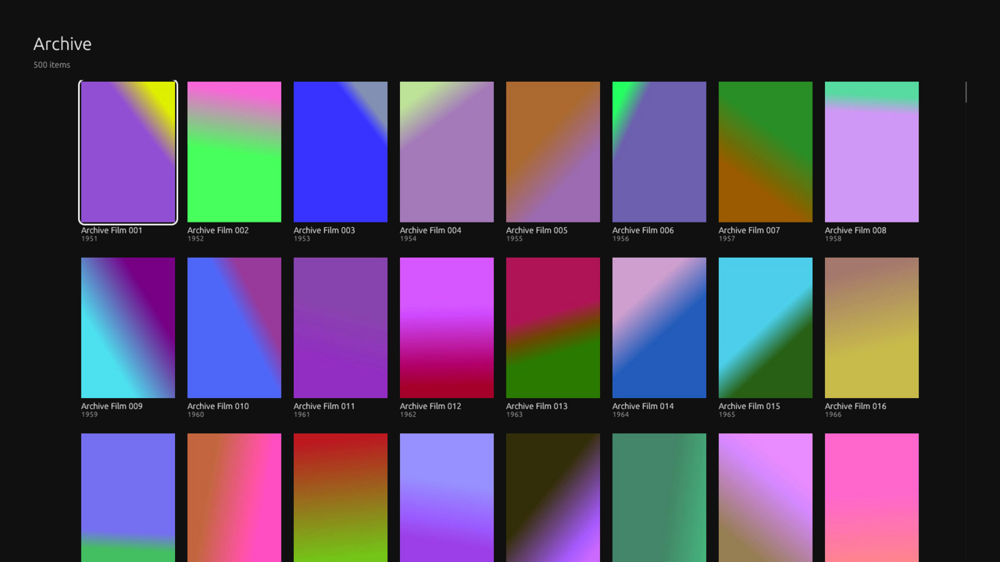
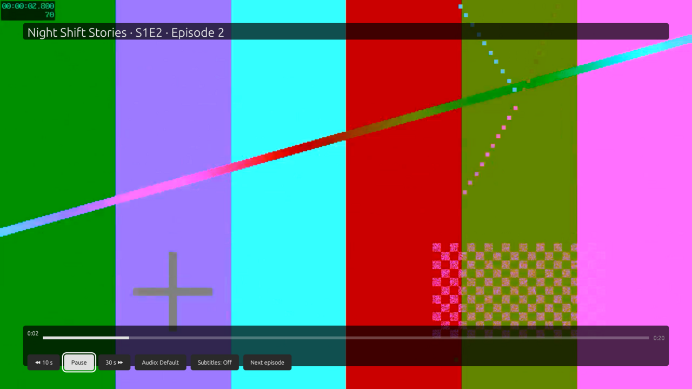

# Rustfin — a fast native Jellyfin client

Rustfin is a desktop client for [Jellyfin](https://jellyfin.org) media servers, written in Rust. It draws its own
interface with [egui](https://github.com/emilk/egui) on OpenGL and plays video with
[libmpv](https://mpv.io). No web view, no Electron: it starts in well under a second and scrolls a 500-film library
at hundreds of frames per second even on software rendering.

It works with any Jellyfin server 10.8 or newer (developed against 10.10).

| | |
|---|---|
|  |  |
|  |  |

*Screenshots from the throwaway test server (generated test videos, made-up titles).*

## Status

Early, but complete enough to use day to day.

- **Windows** (x86_64): zip with `Rustfin.exe` + `libmpv-2.dll`. Cross-built from Linux; tested under Wine.
- **macOS** (Apple Silicon): `Rustfin.app` with libmpv bundled; built and tested on a MacBook.
- **Linux**: builds and runs (it is the development platform), not packaged yet.
- **Samsung TV (Tizen)**: planned. The core is kept TV-ready (OpenGL ES 2.0, remote-only navigation, no browser);
  see `tv/README.md`.

What it does:

- Finds servers on your network (Jellyfin discovery) or takes a typed address.
- Signs in with a password or Quick Connect, and remembers the server and sign-in.
- Home: Continue watching, Next up, Latest per library, Libraries.
- Library grids, film / series / season / episode pages, search.
- Plays with resume, reports progress to the server, mark watched, audio and subtitle picking (including external
  subtitle files), "Up next" countdown and auto-play of the next episode.
- Remote-style keys first (arrows, Enter, Esc/Backspace = back, Space = pause); mouse works too.
- The look is a plain placeholder for now: every colour, size and timing lives in one `Theme` struct
  (`core/src/theme.rs`), so it can be restyled without touching the screens.

## Building

See **[BUILDING.md](BUILDING.md)**, written so that a person or a coding agent can follow it step by step.

## Layout

```
core/      jf-core: Jellyfin API, settings, discovery, screens, drawing, theme (no window, no player)
desktop/   jf-desktop: window, keyboard, libmpv player → the `rustfin` binary
tools/     test server, render tests, benchmarks, packaging (Windows zip, macOS .app), leak gate
tv/        notes for the future Samsung Tizen port
```

## Licence

Rustfin is MIT-licensed (see `LICENSE`). Its Rust dependencies are permissively licensed (MIT / Apache-2.0 / BSD /
ISC / Zlib and similar).

**libmpv is not part of this repository.** The Windows and macOS packages bundle a libmpv build, and those builds are
usually GPL-2.0-or-later (mpv with FFmpeg). If you pass such a package on, you take on the GPL's source-code duty for
libmpv: point to the exact upstream build and its sources (see `tools/package/LICENSES/mpv-and-ffmpeg.txt`), or
include them. Rustfin loads libmpv at run time and keeps its own code MIT.

Jellyfin is a trademark of its respective owners; Rustfin is an independent client and not affiliated with the
Jellyfin project.
